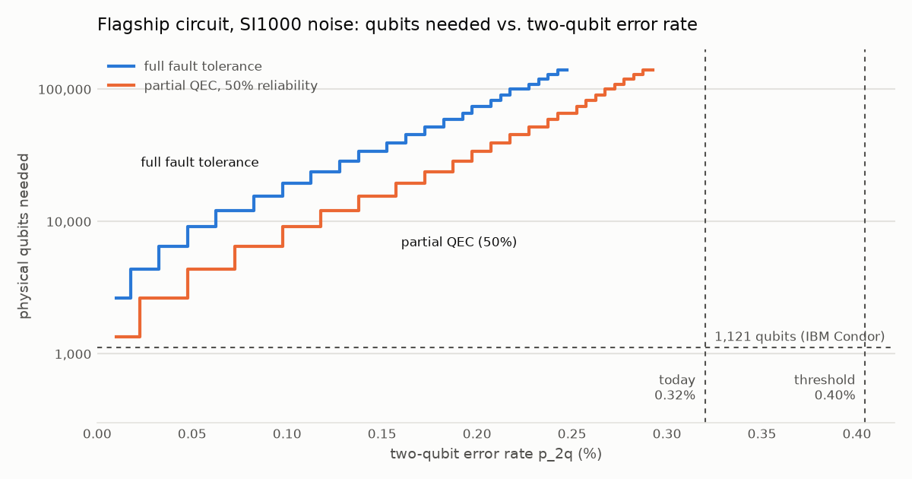
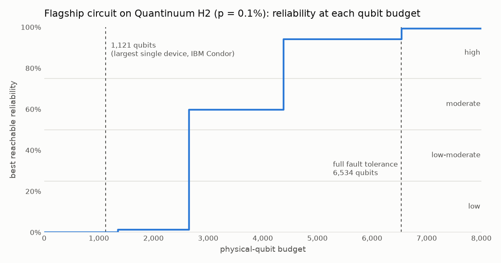

# qregime

**¿QEM, QEC o FTQC? Una capa de decisión abierta y validada para circuitos cuánticos.**

*[Read in English](README.md)*

Antes de correr un circuito cuántico alguien tiene que decidir cómo se van a
manejar los errores: **mitigarlos** sobre los qubits físicos (QEM),
**corregirlos** con un código pequeño (QEC parcial), o pagar la **tolerancia a
fallas completa** (FTQC). Esa decisión define si necesitas 16 qubits físicos o
30.000, y en la práctica suele tomarse a ojo.

`qregime` la vuelve explícita. Le das un circuito OpenQASM 2 y un perfil de
hardware, y te dice:

- qué **técnicas de reducción de circuitos** vale la pena probar primero (y
  cuándo una de ellas está demostrado que no puede ayudar);
- cuánto costaría la **tolerancia a fallas completa**, en qubits físicos y tiempo;
- la **mejor confiabilidad alcanzable con los qubits que realmente tienes**, como
  un cuartil de confianza en vez de un sí/no;
- cuál es el **régimen** más barato que cumple tu objetivo de confiabilidad, o,
  si ninguno lo cumple, **de qué tamaño es la brecha**.

Con ruido superconductor realista (SI1000, umbral ajustado 0,40%), una tasa de
error de 2 qubits de 0,32% está demasiado cerca del umbral: ningún código de
superficie ayuda al circuito insignia. La QEC parcial empieza a servir por debajo
de ~0,29%, la tolerancia a fallas completa por debajo de ~0,25%, y se vuelve
asequible (menos de 20.000 qubits) solo cerca de 0,1%:



En iones atrapados con 0,1% el mismo circuito sí está al alcance:



La QEC parcial llega a 60% de confiabilidad con 2.646 qubits físicos (d=7), el 40%
del costo de la tolerancia a fallas completa (6.534 con d=11). Y en hardware con 99,99% de fidelidad, el mismo circuito no
necesita corrección de errores en absoluto (ver el
[tutorial](tutorial/qregime_tutorial.ipynb)).

## Inicio rápido

```bash
pip install git+https://github.com/MaldoAlberto/qregime.git
qregime hardware
qregime decide mi_circuito.qasm --hardware trapped_ion_quantinuum_h2 --budget 5000
```

```python
import qregime

r = qregime.decide_regime("mi_circuito.qasm", hardware="superconductor_ibm",
                          physical_qubit_budget=1121, reliability_target=0.5)
print(r["regime"], r["cost_physical_qubits"])
```

El [tutorial](tutorial/qregime_tutorial.ipynb) (en inglés, ~2 minutos de
ejecución) recorre cada paso con circuitos reales.

## Qué hay detrás de los números

- **Umbral del código de superficie ajustado con simulación propia, por modelo de ruido**:
  0,40% (SI1000, superconductores), 0,85% (reposo barato, iones atrapados), 0,65% (SD6, CX nativo),
  con Deltakit + PyMatching y verificado contra Stim (`examples/deltakit_crosscheck.py`).
- **Proposición 1 (demostrada):** ZX-calculus no puede reducir el T-count
  cuando todo el contenido no-Clifford es una capa de rotaciones diagonales
  $Z_aZ_b$ (capas de costo de QAOA, pasos de Trotter de Ising). Medido: 0% de
  reducción en 24/24 instancias de QAOA.
- **Proposición 3 (demostrada):** la mejor confiabilidad alcanzable nunca
  baja al crecer el presupuesto, así que el barrido del gráfico es óptimo.
- **Generaliza a circuitos más grandes** que los usados para calibrarlo: 73,7%
  de acierto contra 57,9% de baseline en 19 circuitos nunca vistos de hasta 32 qubits.

**Y lo que no funcionó**, reportado con la misma visibilidad: ningún predictor
estructural de "¿ayudará ZX-calculus?" supera el baseline en *familias de
circuitos nuevas* (una cifra de 82,9% que reportamos primero se retractó al
validarla con leave-one-family-out); QAOA optimizado nunca le ganó a simulated
annealing clásico en 27 instancias; y los circuitos dinámicos todavía no se
pueden procesar. Todo el detalle, incluyendo cada corrección, está en
[el paper](paper/paper_en.pdf).

## Por qué es código abierto

1. **Decisiones tan caras tienen que poder auditarse.** Elegir un régimen
   define cuánto hardware construir, alquilar o esperar. La mayoría de los
   estimadores de recursos son servicios cerrados o atados al hardware de un
   solo fabricante. Acá cada umbral, fórmula y supuesto está en el código, con
   su fuente, y se puede cuestionar.
2. **El resultado principal solo es creíble si cualquiera puede repetirlo.**
   Este proyecto retractó sus propios números más de una vez tras validarlos
   con más rigor. Esa disciplina no vale nada si nadie más puede repetir las
   verificaciones con los mismos datos y el mismo código.
3. **Los resultados negativos le ahorran tiempo a otros.** "Ningún predictor
   estructural barato generaliza a familias nuevas" o "ZX-calculus está
   demostrado que no ayuda en capas de costo diagonales" casi nunca se
   publican, y son justo lo que necesita saber la próxima persona que lo intente.
4. **Agnóstico de hardware significa que cualquiera puede probar su equipo.**
   Un perfil de hardware son tres números. Con código abierto, cualquier
   laboratorio, empresa o estudiante puede evaluar su dispositivo sin pedir permiso.
5. **Un investigador independiente no puede terminarlo solo.** Las
   limitaciones de arriba son problemas concretos y acotados; el código abierto
   es la forma de resolverlos.
6. **Está construido sobre código abierto.** Qiskit, PyZX, Stim, PyMatching y
   NetworkX lo hicieron posible; esta es nuestra devolución.

## Cómo contribuir

Toda contribución suma, desde un typo hasta un perfil de hardware nuevo. Ver
[CONTRIBUTING.md](CONTRIBUTING.md). Buenos puntos de partida: traducir al
inglés los textos de las recomendaciones, agregar perfiles de hardware con su
fuente publicada, o validar la QEC parcial a distancias pequeñas.

## Licencia

[Apache 2.0](LICENSE), la misma licencia que Qiskit, PyZX y Stim.
