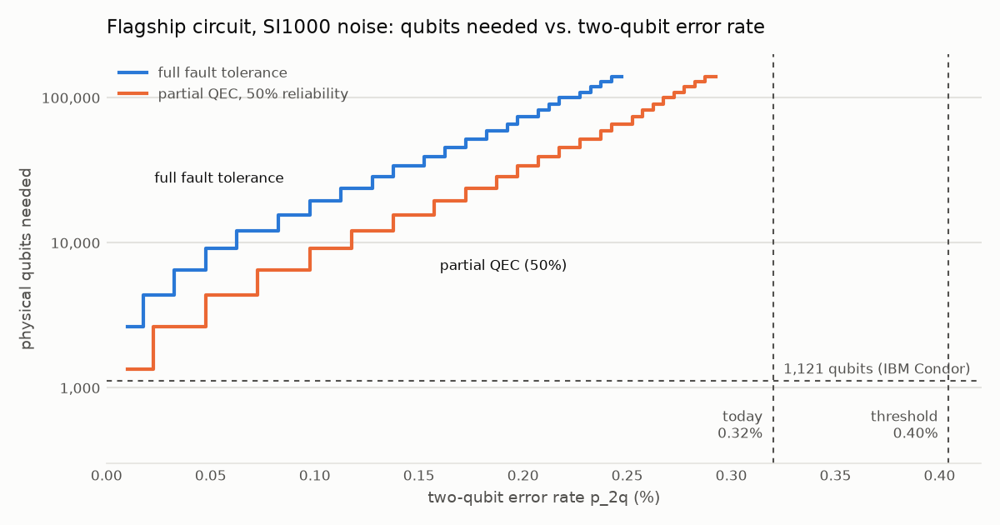
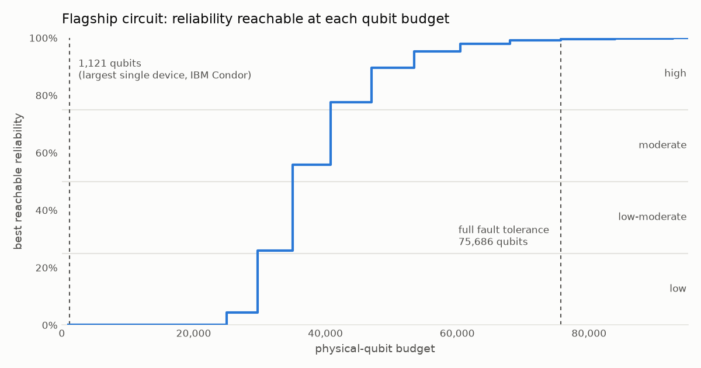

# qregime

**QEM, QEC or FTQC? A validated, open decision layer for quantum circuits.**

[](https://github.com/MaldoAlberto/qregime/actions/workflows/ci.yml)
[](LICENSE)
[](pyproject.toml)
[](paper/paper_en.pdf)

*[Leer en español](README.es.md)*

Before you run a quantum circuit, someone has to decide how errors will be
handled: **mitigate** them on raw physical qubits (QEM), **correct** them with a
small code (partial QEC), or pay for **full fault tolerance** (FTQC). That choice
decides whether you need 16 physical qubits or 30,000, and in practice it is
usually made by rule of thumb.

`qregime` makes it explicit. Give it an OpenQASM 2 circuit and a hardware
profile, and it tells you:

- which **circuit-reduction techniques** are worth trying first (and when one
  provably cannot help);
- what **full fault tolerance** would cost, in physical qubits and runtime;
- the **best reliability reachable with the qubits you actually have**, as a
  confidence quartile instead of a pass/fail bit;
- which **regime** is the cheapest that meets your reliability target -- or, if
  none does, **how large the gap is**.

```console
$ qregime decide examples/circuits/shor_like_sequential.qasm

Circuit   examples/circuits/shor_like_sequential.qasm
          16 qubits, 28618 gates, T-count 3930
Hardware  Superconducting (IBM heavy-hex)  (p_2q = 0.0032, noise model si1000)
Budget    1,121 physical qubits, reliability target 50%

Techniques worth trying:
  [yes ] rzz_gate_teleportation
  [yes ] zx_calculus_tcount_reduction
  [yes ] measurement_based_uncomputation
  [no  ] bounded_qcp_mid_circuit_measurement
  [WARN] possible_classical_shortcut

Regime comparison:
  QEM           16 qubits   reliability 0.0%   (noisy_simulation (150 shots))
  FTQC  not feasible: no code distance up to d=51 meets the logical error budget (p_2q is too close to the fitted threshold)

=> Regime: GAP
   QEM falls short by 50.0% reliability; FTQC is not feasible.
   Best reachable within budget: d=3, reliability 0.0% (quartile 1, low).
   FTQC across noise models: sd6 73,926, si1000 infeasible, toy 33,750.
   Warning: p_2q is above half of at least one fitted threshold; the noise model, not the fit, dominates the uncertainty.
```

"GAP" is a real answer, not an error. Under realistic superconducting noise
(SI1000, fitted threshold 0.40%), a two-qubit error rate of 0.32% is too close to
threshold for *any* surface-code distance to help this circuit. How much better
would the hardware have to be? Sweeping the error rate answers that:



Partial QEC starts to work below ~0.29%, full fault tolerance below ~0.25%, and
it gets affordable (under 20,000 qubits) only around 0.1%.

On trapped-ion hardware at 0.1% the same circuit is within reach, and sweeping
the qubit budget shows what each extra qubit buys:



Partial error correction reaches 60% reliability at 2,646 physical qubits (d=7),
40% of the cost of full fault tolerance (6,534 at d=11). On 99.99%-fidelity
hardware the same circuit needs no error correction at all (see the
[tutorial](tutorial/qregime_tutorial.ipynb)).

## Quickstart

```bash
pip install git+https://github.com/MaldoAlberto/qregime.git
qregime hardware                                  # list hardware profiles
qregime decide my_circuit.qasm --hardware trapped_ion_quantinuum_h2 --budget 5000
```

```python
import qregime

r = qregime.decide_regime("my_circuit.qasm", hardware="superconductor_ibm",
                          physical_qubit_budget=1121, reliability_target=0.5)
print(r["regime"], r["cost_physical_qubits"])
# up to 10 qubits, the QEM reliability comes from the profile's device
# calibration (IBM Torino, Google Willow, IQM Garnet, Quantinuum H2-2,
# IonQ Forte) or your own JSON file; see
# docs/calibrations.md. use_calibration=False keeps the depolarizing model.
print(r["qem"]["mitigation"]["total_shots"])         # shots ZNE needs for +/-0.01
qregime.decide_regime("small.qasm", calibration="my_device.json")
# ZNE bias on the device calibration (<= 10 qubits)
qregime.decide_regime("small.qasm", simulate_mitigation=True)["qem"]["mitigation"]["simulated"]

qregime.recommend("my_circuit.qasm")                 # which reductions to try
qregime.estimate_ftqc(16, tcount=3930, p_phys=0.001,  # full fault-tolerance cost
                      noise_model="toy")
qregime.estimate_ftqc_band(16, 3930, 0.001)           # same, under every noise model
qregime.best_within_budget(16, 3930, 0.001, 5_000,   # best point under a hard budget
                           noise_model="toy")
qregime.estimate_zne_cost(0.5, precision=0.01)       # ZNE shots from unmitigated reliability
```

Then work through **[the tutorial](tutorial/qregime_tutorial.ipynb)** (about 2
minutes to run), or `python examples/demo.py` for a one-screen comparison of six
circuits.

## What is behind the numbers

Every number the tool reports comes from code in this repository that you can
rerun, not from a vendor service.

| Result | Evidence |
|---|---|
| Surface-code threshold fitted per noise model from our own simulations: 0.40% (SI1000, superconducting), 0.85% (cheap idles, trapped ion), 0.65% (SD6, native CX) | Deltakit rotated planar code + PyMatching, `research/qec/fit_threshold_deltakit.py`; cross-checked against Stim in `examples/deltakit_crosscheck.py` |
| **Proposition 1 (proved):** ZX-calculus cannot reduce T-count when the non-Clifford content is one layer of diagonal $Z_aZ_b$ rotations (QAOA cost layers, Ising Trotter steps) | Proof in the paper; 0% measured reduction on 24/24 QAOA instances and on a circuit derived from IBM's 2023 utility experiment |
| **Proposition 3 (proved):** the best reliability reachable under a budget can never decrease as the budget grows, so the sweep above is provably optimal | Proof in the paper; checked numerically in `tests/test_proposition3.py` |
| Partial QEC reaches the same reliability bar at ~40% of the qubits of full fault tolerance on the flagship circuit (trapped ion, 0.1%) | 2,646 vs 6,534 physical qubits |
| On superconducting noise at 0.32%, no surface code helps the flagship circuit; error correction needs p_2q below ~0.25-0.29% | `examples/error_rate_sweep.py` |
| Audit against theory and literature: 7 theory checks (closed-form distance, Lambda = p_th/p, monotonicity, Proposition 1, ...) and 7 literature checks (Fowler 2012, Gidney et al. 2021, Google Willow 2024, Litinski 2019) | `research/audit/literature_audit.py`: 14 PASS, 0 WARN, 0 FAIL |
| The technique recommender generalizes to circuits larger than it was calibrated on: 73.7% accuracy vs a 57.9% baseline on 19 unseen circuits of up to 32 qubits | `research/decision-layer/large_scale_*` |
| Cheap enough to run before dispatch: profiling + recommendations take 0.06-1 s on most reference circuits, 11.6 s on the heaviest | after fixing three scaling bugs found by our own stress test (44 s before) |

**And what did not work**, reported just as prominently:

- No structural predictor of "will ZX-calculus help?" beats the majority
  baseline on *unseen circuit families*. An 82.9% figure we first reported
  dropped to 70.4% (= baseline) under leave-one-family-out validation and was
  retracted; logistic regression and decision trees on eight features score
  62.2% and 52.0%. The same models score 94.7% on unseen *sizes* of known
  families: they generalize across scale, not across structure.
- Optimized QAOA at depth 1-3 never beat classical simulated annealing on any
  of 27 MaxCut instances.
- Dynamic circuits (mid-circuit measurement with classically controlled
  arbitrary-angle corrections) cannot be ingested yet, by this tool or by the
  ZX-calculus prototype we tested.

The full account, including every correction, is in **[the paper](paper/paper_en.pdf)**.

## Why this is open source

1. **Decisions this expensive should be auditable.** Choosing a regime decides
   how much hardware to build, rent or wait for. Most resource estimators are
   closed services or tied to one vendor's hardware. Here every threshold,
   formula and assumption is in the code, with its source, and can be
   challenged.
2. **Our main result is only credible if you can rerun it.** This project
   retracted its own numbers more than once after stricter validation. That
   discipline means nothing unless anyone can repeat the checks, on the same
   data, with the same code.
3. **Negative results save other people time.** "No cheap structural predictor
   generalizes to new circuit families" and "ZX-calculus provably cannot help
   on diagonal cost layers" are rarely published, and they are exactly what
   the next person trying the same thing needs to know.
4. **Hardware-agnostic means anyone can plug in their device.** A hardware
   profile is three numbers. Open code lets every hardware team, lab or
   student evaluate their own device without asking permission.
5. **One independent researcher cannot finish this alone.** The limitations
   above are concrete, scoped problems. Open source is how they get solved.
6. **It stands on open source.** Qiskit, PyZX, Stim, PyMatching and NetworkX
   made it possible; this is our contribution back. qregime itself needs no
   quantum SDK: it reads OpenQASM 2 and simulates with numpy. Qiskit and
   Qiskit Aer are optional (`pip install "qregime[qiskit]"`) and only speed
   up noisy simulation of 11-20 qubit circuits.

## Contributing

Contributions of any size are welcome, from a typo to a new hardware profile.
Good places to start (details in [CONTRIBUTING.md](CONTRIBUTING.md)):

- translate the recommendation `reason` strings and code comments (currently Spanish) to English;
- add a hardware profile for a device you know, with its published source;
- a mechanism-based ZX-calculus predictor from phase-polynomial parities (the idea is in the paper's discussion);
- validate partial QEC at small code distances (d = 3-11) against simulation;
- support for dynamic circuits.

## Citing

If you use `qregime` or its results, please cite the paper; GitHub's "Cite this
repository" button uses [CITATION.cff](CITATION.cff).

## Repository layout

```
src/qregime/     the installable package (public API in api.py, CLI in cli.py)
tutorial/        executed Jupyter tutorial
examples/        demo scripts and the reference QASM circuits
tests/           unit and regression tests, including the paper's numbers
paper/           the paper (PDF and LaTeX source)
research/        the raw research archive behind every number in the paper
docs/            figures and the dissemination kit
```

## License

[Apache 2.0](LICENSE), the same license as Qiskit, PyZX and Stim.
