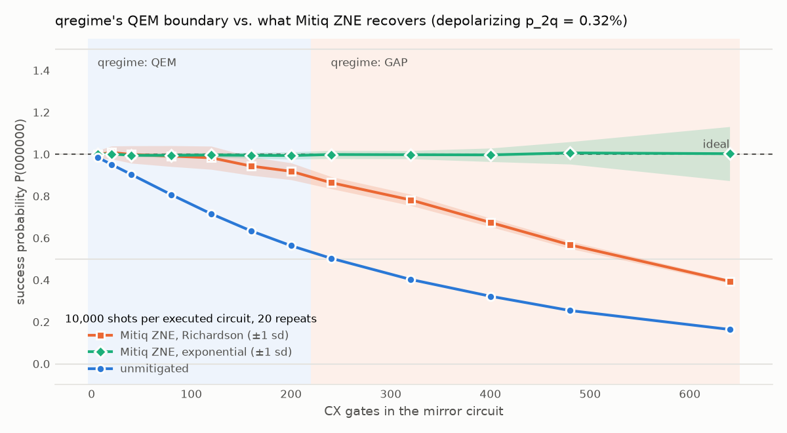
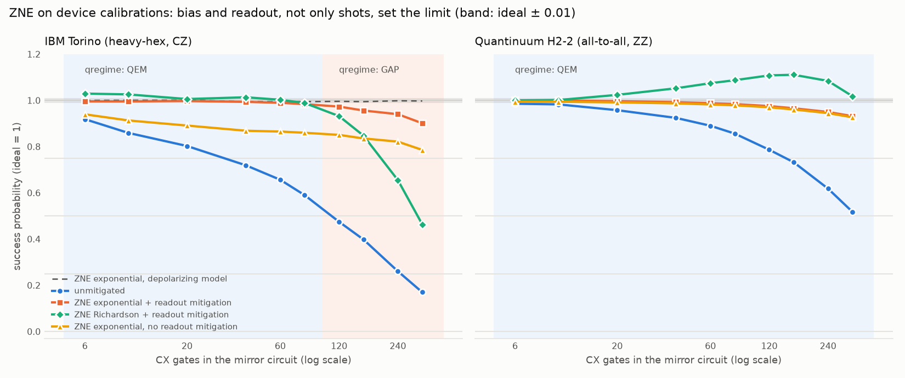

# qregime and Mitiq: decide, then mitigate

qregime and [Mitiq](https://github.com/unitaryfoundation/mitiq) work at
different layers:

- **qregime** answers the question before mitigation: should this circuit be
  mitigated (QEM), partially error-corrected, or run fault-tolerantly, and at
  what cost?
- **Mitiq** answers the next question: how to mitigate it (ZNE, PEC, CDR,
  DDD, readout mitigation).

```
circuit -> qregime -> QEM   -> Mitiq
                   -> QEC   -> Deltakit / Stim
                   -> FTQC  -> Azure QRE / QREChem
```

[`examples/qregime_to_mitiq.py`](../examples/qregime_to_mitiq.py) hands
circuits from one to the other and compares qregime's QEM boundary with what
Mitiq's zero-noise extrapolation actually recovers.

## Setup

- **Circuits:** 6-qubit layered mirror circuits U U† (RY rotations and a CX
  brickwork), 6 to 640 CX gates. The ideal output is |000000⟩, so the ideal
  success probability is 1.
- **Noise:** depolarizing two-qubit noise at the IBM heavy-hex profile's
  p_2q = 0.32%. This is the same noise qregime simulates.
- **qregime:** `decide_regime` with its default 50% reliability target.
- **Mitiq:** ZNE with scale factors 1, 2, 3 and random gate folding. Two
  extrapolations: Richardson, and exponential (`ExpFactory`, asymptote 1/2⁶).
  Each executed circuit gets 10,000 shots, and every point is repeated 20
  times.



## Results

| CX | qregime | qregime reliability | Raw (exact) | ZNE Richardson | ZNE exponential |
|---|---|---|---|---|---|
| 40 | QEM | 0.904 | 0.903 | 0.999 ± 0.042 | 0.995 ± 0.007 |
| 120 | QEM | 0.693 | 0.715 | 0.983 ± 0.055 | 0.996 ± 0.011 |
| 200 | QEM | 0.545 | 0.564 | 0.918 ± 0.040 | 0.994 ± 0.017 |
| 240 | GAP | 0.481 | 0.504 | 0.864 ± 0.029 | 0.999 ± 0.019 |
| 400 | GAP | 0.295 | 0.322 | 0.674 ± 0.020 | 0.997 ± 0.032 |
| 640 | GAP | 0.141 | 0.164 | 0.394 ± 0.009 | 1.002 ± 0.129 |

(± is the standard deviation over 20 repeats; ideal = 1.)

1. **qregime's reliability prediction is accurate.** Its noisy simulation
   tracks the exact unmitigated success within 0.03 at every depth.
2. **Richardson ZNE fails where qregime leaves QEM.** Its error stays at or
   below 0.09 while qregime says QEM, and grows to 0.14 at the boundary and
   0.61 at 640 CX. The failure is bias, not noise: the spread stays at
   0.01-0.06.
3. **Exponential ZNE keeps working far past qregime's boundary.** Under pure
   depolarizing noise, decay is exactly exponential, which is the best case
   for this extrapolation. Its mean stays within 0.01 of the ideal up to
   640 CX, while its spread grows from 0.002 to 0.13.
4. **The real limit is shots.** For ±0.01 precision with exponential ZNE,
   each executed circuit needs about 5,500 shots at 40 CX, 38,000 at the
   qregime boundary (240 CX), and 1.7 million at 640 CX.

## What this means

- qregime's QEM column is the **unmitigated** reliability. On this benchmark
  it is conservative: a well-chosen ZNE recovers circuits that qregime sends
  to GAP.
- That benchmark is ZNE's best case. Real devices add noise that does not
  decay exponentially (coherent errors, leakage, drift; see the IBM
  Nighthawk case study in `research/case_studies/`, where measured Λ was
  four times below the calibration model). There, extrapolation bias returns.
- **qregime now reports that cost.** `decide_regime(...)["qem"]["mitigation"]`
  gives the shots exponential ZNE needs for ±0.01 precision, and
  `qregime.estimate_zne_cost(reliability, precision)` computes it directly.
  The model propagates binomial shot noise through the least-squares
  exponential fit (`src/qregime/mitigation.py`). On this benchmark its
  predicted spread is within about 30% of Mitiq's measured spread at every
  depth (`tests/test_mitigation.py`). It assumes no extrapolation bias, so it
  is a lower bound on real hardware; see the next section for the bias. The decision becomes "mitigate at
  N shots, or correct at M qubits", which is the comparison a user actually
  faces.

## Under real device calibrations

The benchmark above is ZNE's best case. `qregime.mitigation.simulate_zne`
(also `decide_regime(..., simulate_mitigation=True)` and `qregime decide
--zne`) runs ZNE on a device calibration instead (see
[calibrations.md](calibrations.md)). The circuit is mapped onto the device,
compiled to its native gates, its native ops are locally folded, and every
scaled circuit is simulated exactly (density matrix, so no sampling noise in
the bias). [`examples/zne_calibrated.py`](../examples/zne_calibrated.py)
runs the same kind of 6-qubit mirror circuits on two devices:

- **IBM Torino** (FakeTorino snapshot): heavy-hex coupling, CZ gates,
  per-qubit errors, T1/T2 during gates and idle times, readout errors.
- **Quantinuum H2-2** (published emulator parameters): all-to-all ZZ gates,
  memory error per layer, asymmetric readout.



IBM Torino:

| CX | Unmitigated | ZNE exp. | ZNE exp. + readout mit. | ZNE Richardson + readout mit. | Shots for ±0.01 (exp. + readout mit.) |
|---|---|---|---|---|---|
| 6 | 0.92 | 0.940 | 0.996 | 1.030 | 2,769 |
| 20 | 0.80 | 0.891 | 0.998 | 1.006 | 11,967 |
| 60 | 0.66 | 0.865 | 0.990 | 1.003 | 38,556 |
| 120 | 0.48 | 0.851 | 0.973 | 0.932 | 125,343 |
| 240 | 0.26 | 0.822 | 0.940 | 0.655 | 901,950 |
| 320 | 0.17 | 0.786 | 0.901 | 0.464 | 5,811,111 |

Quantinuum H2-2:

| CX | Unmitigated | ZNE exp. | ZNE exp. + readout mit. | ZNE Richardson + readout mit. | Shots for ±0.01 (exp. + readout mit.) |
|---|---|---|---|---|---|
| 6 | 0.99 | 0.995 | 1.000 | 1.000 | 912 |
| 20 | 0.96 | 0.991 | 0.997 | 1.024 | 3,918 |
| 60 | 0.89 | 0.983 | 0.988 | 1.075 | 12,183 |
| 120 | 0.79 | 0.970 | 0.976 | 1.108 | 28,986 |
| 240 | 0.62 | 0.945 | 0.950 | 1.084 | 76,119 |
| 320 | 0.52 | 0.927 | 0.932 | 1.018 | 133,146 |

(All rows are in `zne_calibrated.json`.)

1. **On IBM, ZNE without readout mitigation never reaches the ideal value.**
   Folding does not amplify readout error, so the extrapolation stops at
   the readout floor (0.94 even at 6 CX). ZNE has to be paired with readout
   mitigation. On H2-2, readout error is small enough that this barely
   matters.
2. **Bias sets the limit before shots do.** Exponential ZNE with readout
   mitigation stays within ±0.01 up to 60 CX on IBM and 40 CX on H2-2; at
   120 CX its bias is 0.027 and 0.024. Under the depolarizing model the
   bias stayed below 0.01 up to 640 CX.
3. **Richardson is unreliable on both.** It falls short on IBM beyond
   80 CX and overshoots the ideal value by up to 0.11 on H2-2.
4. **The depolarizing model is optimistic.** On IBM it predicts 0.85 at
   60 CX, where the calibration gives 0.66, and it keeps QEM up to 240 CX;
   with the calibration the boundary is at 120 CX.

Not modelled: leakage, crosstalk and drift (absent from both calibrations),
and coherent errors unless a calibration sets `zz_overrotation`. On
hardware they add bias. The shot counts with readout mitigation ignore the
extra variance that readout inversion adds.

### qregime's decision uses the calibration

For circuits up to 10 qubits whose ideal output is concentrated,
`decide_regime` takes the QEM reliability from the hardware profile's
calibration (`superconductor_ibm` uses `ibm_torino`,
`trapped_ion_quantinuum_h2` uses `quantinuum_h2_2`; `reliability_source`
starts with `calibrated_simulation`). Pass `calibration=` (a bundled name,
a JSON file or a dict) to use another device, and `use_calibration=False`
or `qregime decide --no-calibration` for the depolarizing model. On the IBM
mirror circuits, with the default 50% target:

| CX | Depolarizing model | IBM Torino calibration (default) |
|---|---|---|
| 60 | QEM (0.85) | QEM (0.66) |
| 80 | QEM (0.80) | QEM (0.59) |
| 120 | QEM (0.71) | GAP (0.48) |
| 160 | QEM (0.64) | GAP (0.40) |
| 240 | QEM (0.51) | GAP (0.26) |

The QEM boundary moves from 320 CX to 120 CX. On H2-2 all these circuits
stay QEM. The reliability is the unmitigated one, readout error included.
Larger circuits and circuits whose output support covers most bitstrings
keep the previous sources; `qem["calibration"]["reason"]` says why. The
example circuits in `examples/circuits/` are all in that group, so their
decisions do not change.

Run (about 12 minutes):

```bash
pip install -e ".[compare]"
python examples/qregime_to_mitiq.py   # writes docs/qregime_to_mitiq.png and .json

python examples/zne_calibrated.py     # writes docs/zne_calibrated.png and .json (~1 min)
```
