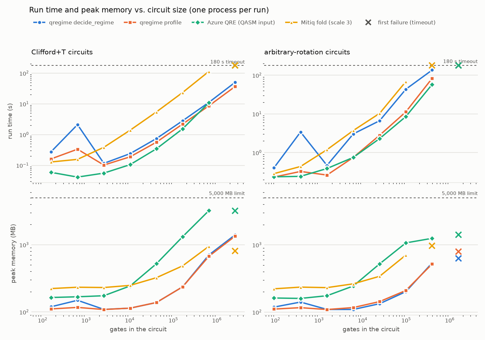

# Performance and stress test: qregime vs. Azure QRE, QREChem and Mitiq

How large a circuit can each tool handle on a laptop, and what does it cost in
time and memory? This report runs every tool on generated circuits of growing
size until it fails, and reports where each one stops.

- **Script:** [`perf_stress.py`](perf_stress.py)
- **Raw results:** [`perf_stress_results.json`](perf_stress_results.json)
- **Figure:** [`plot_perf_stress.py`](plot_perf_stress.py), which writes `docs/perf_stress.png`

## Setup

| | |
|---|---|
| Machine | Apple M1, 8 GB RAM, macOS |
| Commit | `bc4ce6e` (qregime 0.1.x), Python 3.11 |
| Limits per run | 180 s wall time, 5,000 MB resident memory |
| Isolation | each run is its own process, so a crash or memory blow-up cannot affect the next run |
| Sizes | n = 8, 16, 32, ..., 1024 qubits (ZNE: n = 2, 4, ..., 12) |
| Stop rule | a tool stops climbing at its first failure |
| Repetitions | one run per point; small timings (< 1 s) are noisy |

Two circuit families, each with n qubits and n layers, so the gate count grows
as n²:

- **`clifford_t`:** each layer applies H and T on every qubit, then a CX
  brickwork. It has n² exact T gates.
- **`rotations`:** each layer applies RZ(θ) on every qubit, with θ never a
  multiple of π/4, then a CX brickwork. It has n² arbitrary rotations, which a
  fault-tolerant machine must synthesize.

"Run time" is the operation alone, without Python start-up or imports. "Peak
memory" is the process's maximum resident set, so it includes the interpreter
and the imported libraries (about 95-240 MB depending on the tool).

## What each operation does

The tools do not answer the same question, so the timings compare cost, not
equivalent work.

| Operation | Input | What it computes |
|---|---|---|
| `qregime.profile` | QASM file | parse, T-count (pyzx), depth, two-qubit count |
| `qregime.decide_regime` | QASM file | full QEM / partial QEC / FTQC decision; adds a noisy simulation when n ≤ 20 |
| `qregime.estimate_ftqc` | n, T-count | analytic fault-tolerant cost |
| `azure.qasm` | QASM file | Azure QRE (`qdk`) parsing the circuit and estimating resources |
| `azure.counts` | logical counts | Azure QRE model only, no circuit |
| `qrechem.formula` | n, T-count | QREChem's logical-error formula inside qregime's estimator |
| `mitiq.fold` | QASM file | Mitiq unitary folding at scale 3 (Mitiq's own overhead only, nothing executed) |
| `mitiq.zne` | QASM file | full ZNE, Richardson at scales 1-2-3, exact density-matrix simulation with Qiskit Aer |

## Results



Largest size each operation finished, and its cost there:

| Family | Operation | Largest n passed | Gates | Run time | Peak memory | First failure |
|---|---|---|---|---|---|---|
| clifford_t | `qregime.profile` | 1024 | 2,620,928 | 36.9 s | 1,345 MB | none |
| clifford_t | `qregime.decide_regime` | 1024 | 2,620,928 | 50.5 s | 1,407 MB | none |
| clifford_t | `azure.qasm` | 512 | 655,104 | 10.9 s | 3,225 MB | timeout at n=1024 |
| clifford_t | `mitiq.fold` | 512 | 655,104 | 114.4 s | 949 MB | timeout at n=1024 |
| clifford_t | `mitiq.zne` | 12 | 354 | 106.3 s | 493 MB | none (ladder ends at 12) |
| rotations | `qregime.profile` | 512 | 392,960 | 83.1 s | 519 MB | timeout at n=1024 |
| rotations | `qregime.decide_regime` | 512 | 392,960 | 136.0 s | 538 MB | timeout at n=1024 |
| rotations | `azure.qasm` | 512 | 392,960 | 57.7 s | 1,249 MB | timeout at n=1024 |
| rotations | `mitiq.fold` | 256 | 98,176 | 68.6 s | 705 MB | timeout at n=512 |
| rotations | `mitiq.zne` | 10 | 145 | 15.2 s | 259 MB | timeout at n=12 |

The three analytic estimators (`qregime.estimate_ftqc`, `azure.counts`,
`qrechem.formula`) finished every size in both families in under 3 ms and
under 105 MB. Their cost does not depend on the circuit, because they only
take n and the non-Clifford count.

No run hit the 5,000 MB memory limit. Every failure was a timeout.

## Findings

1. **On Clifford+T circuits qregime goes furthest.** It is the only
   circuit-reading tool that finished n=1024 (2.6 million gates). The full
   decision took 50.5 s and 1.4 GB. Azure QRE timed out at the same size.
2. **qregime uses less memory than Azure QRE at every size when both read the
   circuit.** At n=512, the full `decide_regime` used 706 MB against 3,225 MB
   for Azure on `clifford_t` (4.6 times less), and 538 MB against 1,249 MB on
   `rotations` (2.3 times less).
3. **Azure QRE parses faster at medium size on Clifford+T.** From 2,544 to
   163,712 gates it ran 1.4-1.8 times faster than `qregime.profile`. At
   655,104 gates the order flips: qregime took 8.7 s, Azure 10.9 s. On
   `rotations` the two stay within a factor of 1.5 at every size.
4. **On arbitrary rotations qregime is slower than Azure and stops at n=512.**
   At n=512, `qregime.profile` took 83.1 s against 57.7 s for Azure.
   `decide_regime` took 136 s. See the next section for the cause.
5. **Mitiq's folding alone costs more than qregime's whole decision.** At
   n=128 on `clifford_t`, folding took 5.5 s against 0.74 s for
   `decide_regime`. Folding timed out at n=1024 (`clifford_t`) and n=512
   (`rotations`).
6. **Full ZNE is limited by the simulator, not by Mitiq.** Exact density
   matrices grow as 4ⁿ, so ZNE took 106 s at n=12 on `clifford_t` and timed
   out at n=12 on `rotations`. This is the cost of measuring mitigation by
   classical simulation; on hardware the limit would be shots, not memory.
7. **The bump at n=16 in `decide_regime` is the noisy simulation.**
   qregime simulates circuits of 20 qubits or fewer
   (`MAX_QUBITS_FOR_SIMULATION = 20`). At n=16 the decision took 2.1 s
   (`clifford_t`) and 3.4 s (`rotations`); at n=32, without simulation, it
   dropped back to 0.12 s and 0.47 s.

## Known limit: parsing QASM with rotation angles

The `rotations` slowdown is not in qregime's own code. A profile of
`qregime.profile` on `rotations` at n=256 (98,176 gates, 45.3 s under the
profiler) shows:

- **87% of the time (39.6 s) is pyzx's QASM parser** (`pyzx.circuit.from_qasm_file`).
- pyzx parses each `rz` angle with a `lark` grammar, twice per gate
  (`parse_phase_arg` and `symbolic.parse_phase_list`). That is 196,608 `lark`
  parses for 65,536 rotations.
- Clifford+T gates carry no angle, so they skip this path. That is why the
  same circuit size runs about 5 times faster on `clifford_t`.

Possible fixes, not yet done:

- Parse the QASM once with a light parser (or Qiskit) and build the pyzx
  `Circuit` directly, instead of calling `from_qasm_file`.
- Above a size threshold, count non-Clifford gates by gate name and skip the
  pyzx T-count reduction.

## Caveats

- One run per point on one laptop. Times below about 1 s vary between runs.
- Peak memory includes each library's import footprint, which favors the
  tools with lighter imports at small n.
- The circuits are synthetic and regular. Real circuits with deeper
  structure may change pyzx's cost.
- The analytic tools are not doing the same work as the circuit readers. They
  are listed to show that once counts are known, every tool's estimate is
  instant.

## Reproduce

```bash
pip install -e ".[compare]"
python research/comparison/perf_stress.py        # about 40 min on an M1 with 8 GB
python research/comparison/plot_perf_stress.py   # writes docs/perf_stress.png
```
